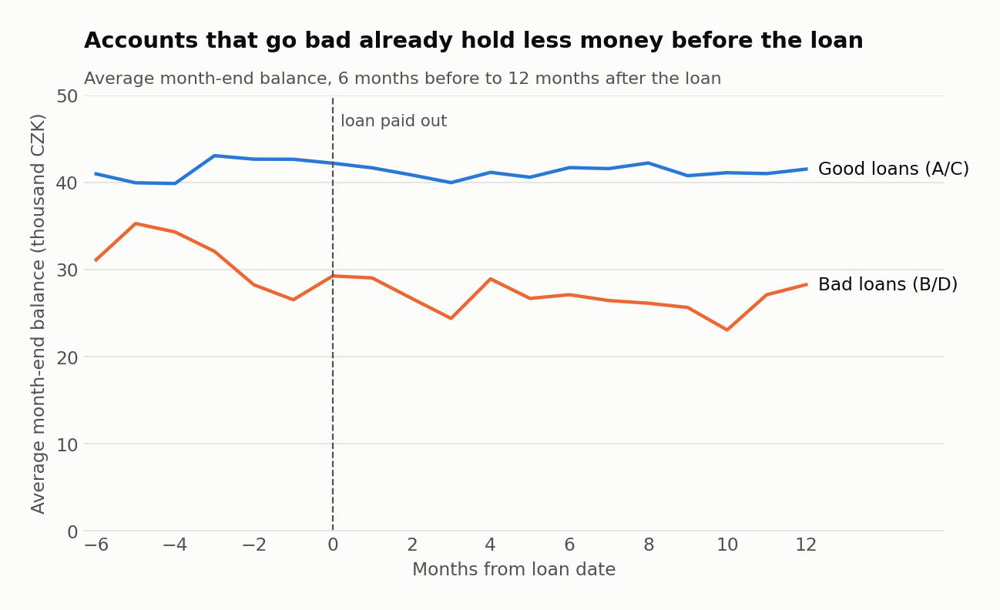
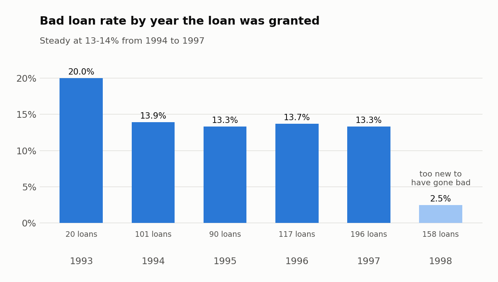
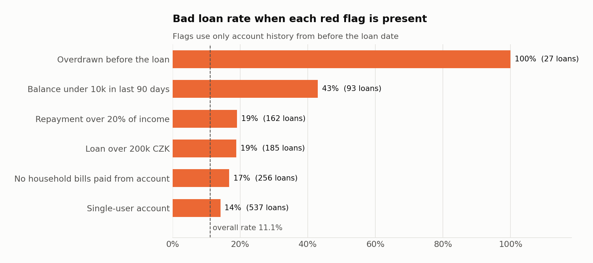
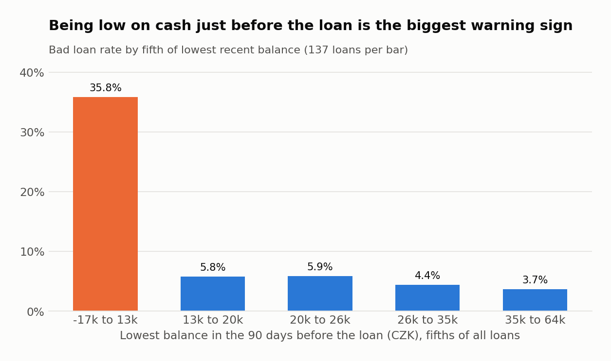
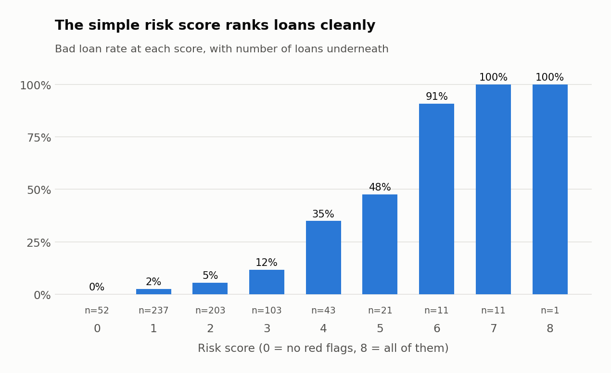

# Retail Bank Loan Risk Analysis (PostgreSQL)

**Which customers stop repaying their loans, and could the bank have seen it coming?**

This is an end-to-end SQL project built on real, anonymised data from a Czech bank: just over a million transactions, 4,500 accounts and 682 loans between 1993 and 1998. I loaded the raw files into PostgreSQL, profiled and cleaned them, built a loan-level feature table that only uses information available at the time of approval, and used it to identify the early warning signs behind bad loans. The project finishes with two practical outputs: a simple points-based risk score for new applications, and a watchlist of current loans that are showing signs of trouble.

**Tools:** PostgreSQL 16 (Docker), SQL, VS Code with SQLTools, Python (pandas and matplotlib for the charts only).



---

## Contents

- [Key findings](#key-findings)
- [Business questions](#business-questions)
- [Analysis](#analysis)
- [Recommendations](#recommendations)
- [Data](#data)
- [Project structure](#project-structure)
- [How to run it](#how-to-run-it)
- [SQL techniques used](#sql-techniques-used)
- [Limitations and next steps](#limitations-and-next-steps)

---

## Key findings

- **11.1% of loans go bad (76 of 682).** Because bad loans tend to be larger, they account for **15.1% of the total amount lent**.
- **An overdraft before the loan is almost a guarantee of trouble.** 27 borrowers had a negative balance at some point before their loan was approved, and all 27 went bad.
- **Low cash in the 90 days before the loan is the strongest single warning sign.** The fifth of borrowers with the lowest recent balance (under ~13k CZK) went bad 35.8% of the time. Every other fifth stayed below 6%.
- **Accounts with a second authorised user never defaulted.** 145 loans sat on shared accounts and none went bad, compared with 14.2% on single-user accounts.
- **District economics make almost no difference.** Local unemployment and average salary show near-zero correlation with the bad loan rate. How a customer manages their account matters far more than where they live.
- **A six-rule points score separates good and bad loans well, using only data available on the application date.** The riskiest 12.8% of loans contain 62% of all bad loans, while the lowest band (289 loans) has a bad rate of just 2.1%.
- **12 loans that are currently up to date already show the same warning signs as loans in arrears.** Together they have around 1.9m CZK left to repay, which gives a collections team a short, focused list to act on.

---

## Analysis

### 1. Portfolio overview

| Metric | Value |
|---|---|
| Clients / accounts | 5,369 / 4,500 |
| Loans | 682 (15.2% of accounts hold one) |
| Total lent | 103.3m CZK |
| Bad loans | 76 (11.1% by count, 15.1% by value) |

The bad loan rate is consistent at 13–14% for loans granted between 1994 and 1997. The 1998 figure of 2.5% looks strong but is misleading: those loans were only a few months old at the end of the data and had not had enough time to go wrong. Any year-on-year comparison needs to account for this.



Loan size is clearly linked to risk. The largest quarter of loans (over ~212k CZK) goes bad 20% of the time, compared with 7.6% for the smallest half. Loan term makes little difference beyond 12 months.

### 2. Customer and account profile

Several factors I expected to matter turned out to have little effect:

- **Gender:** 10.5% for men vs 11.8% for women, which is effectively no difference.
- **Age:** a mild U-shape, from 8.4% for 25–34 year olds up to 14.1% for those aged 55+. Not a strong signal on its own.
- **Region:** ranges from 1.6% to 15.8%, but with only 57–129 loans per region, a handful of loans either way moves the rate considerably.
- **Local economy:** the correlation between district unemployment and bad loan rate is −0.03, and for average salary it is −0.05. In practice, no relationship.

Two findings did stand out:

- **Shared accounts (145 loans) had zero bad loans.** My interpretation is that a second earner in the household provides a genuine financial buffer when money gets tight.
- **The bank never lends to pensioners.** 740 accounts receive a pension, and none of them has a loan. The oldest borrower was 61. This could reflect credit policy or how the dataset was prepared, but it is important context before drawing any conclusions about age.

### 3. What predicts a bad loan

This is the core of the project. For every loan, I built a profile of how the account behaved **before the loan date only** (`sql/04_loan_risk_features.sql`). Using the full account history would have introduced data leakage: the arrears themselves (overdrafts following missed repayments) would make bad loans look obviously bad, and the results would appear far stronger than they really are.



| Red flag (before the loan) | Loans | Bad rate with flag | Bad rate without |
|---|---:|---:|---:|
| Overdrawn at any point | 27 | **100%** | 7.5% |
| Lowest balance in last 90 days under 10k CZK | 93 | **43.0%** | 6.1% |
| Monthly repayment over 20% of monthly income | 162 | 19.1% | 8.7% |
| Loan over 200k CZK | 185 | 18.9% | 8.2% |
| No household bills paid from the account | 256 | 16.8% | 7.7% |
| Single-user account | 537 | 14.2% | 0.0% |

Balance-based signals are by far the strongest. The chart below shows the bad loan rate by the lowest balance held in the three months before the loan:



Affordability behaves as expected: as the repayment takes up a larger share of monthly income, the bad rate rises steadily from 3.6% in the lowest fifth to 20.6% in the highest.

The chart at the top of this page tells the same story over time. Six months before the loan, borrowers who later go bad already hold around 10k CZK less than other borrowers. By the month before the loan, the gap has widened to about 16k CZK (42.7k vs 26.5k).

### 4. Application risk score

I combined the six red flags into a simple points score (`sql/08_risk_drivers_and_scorecard.sql`):

| Rule | Points |
|---|---:|
| Overdrawn at any point before the loan | +2 |
| Lowest balance in the 90 days before the loan under 10,000 CZK | +2 |
| Repayment over 20% of average monthly income | +1 |
| Loan over 200,000 CZK | +1 |
| No household bills paid from the account | +1 |
| Single-user account | +1 |

The bad rate increases at every step of the score:



| Band | Score | Loans | Bad loans | Bad rate | Share of all bad loans |
|---|---|---:|---:|---:|---:|
| Low | 0–1 | 289 | 6 | 2.1% | 7.9% |
| Medium | 2–3 | 306 | 23 | 7.5% | 30.3% |
| High | 4–5 | 64 | 25 | 39.1% | 32.9% |
| Very high | 6–8 | 23 | 22 | 95.7% | 28.9% |

The High and Very high bands make up 12.8% of loans but contain 62% of all bad loans.

I deliberately chose a points score over a statistical model. It is transparent: anyone in the business can read it, check it by hand and challenge it. The natural next step would be a logistic regression on the same feature table to assign proper weights to each signal.

### 5. Early warning watchlist

The score supports decisions on new applications, but the bank also needs to monitor loans already on the books. For the 448 running loans, I looked at the final six months of data (July–December 1998) and tested three warning signals:

| Signal (last 6 months) | Loans in arrears (D) | Loans up to date (C) |
|---|---:|---:|
| Balance fell below one monthly repayment | 48.9% | 2.5% |
| Charged penalty interest (overdrawn) | 31.1% | 0.2% |
| Fewer repayments than expected | 35.6% | 0.5% |
| **Any of the above** | **60.0%** | **3.0%** |

I also tested an "income dropped by more than 20%" signal, but it fired for 14% of healthy loans and only 20% of troubled ones, so I excluded it.

**12 loans that are currently up to date trigger at least one signal**, with around 1.9m CZK still to be repaid (4.7% of the performing book). The full list is available in [`results/early_warning_watchlist.csv`](results/early_warning_watchlist.csv).

---

## Recommendations

1. **Treat any overdraft in the account history as a hard stop**, or at minimum a trigger for mandatory manual review. In this data, 27 out of 27 such loans went bad.
2. **Assess the lowest balance over the last three months, not just the current balance.** An applicant can look healthy on the day they apply while having struggled for the whole quarter.
3. **Cap repayments at around 20% of monthly income for larger loans**, or require a guarantor or joint account holder above that threshold.
4. **Run the early warning watchlist every month.** It is a lightweight query, and it gives the collections team a short list of customers to contact before payments are missed.
5. **Avoid pricing risk by region or district.** The data does not support it, and it would risk penalising customers for where they live rather than how they manage their money.

---

## Data

The [Berka dataset](https://github.com/jlacko/berka-dataset) was released for the PKDD'99 Discovery Challenge. It contains real, anonymised data from a Czech bank.

| File | Rows | Description |
|---|---:|---|
| account.asc | 4,500 | Bank accounts |
| client.asc | 5,369 | Customers |
| disp.asc | 5,369 | Which customer can use which account |
| card.asc | 892 | Credit cards |
| loan.asc | 682 | Loans and their status |
| order.asc | 6,471 | Standing orders |
| trans.asc | 1,056,320 | All transactions |
| district.asc | 77 | District demographics |

The original column descriptions are in [`data/Financial Data description.pdf`](data/Financial%20Data%20description.pdf).

### Data quality issues and how I handled them

Structurally the dataset is fairly clean (no duplicate keys and no orphan rows), but I found several undocumented quirks during profiling:

- **Undocumented transaction type.** Alongside `PRIJEM` (credit) and `VYDAJ` (debit), 16,666 rows have the type `VYBER`. I verified this using the balance arithmetic: on single-transaction days, it reconciles as a debit 10,697 times and as a credit 0 times, so I treated it as a debit.
- **Blank operations.** 183,114 transactions have an empty operation field. Every one of them is an interest credit (`UROK`), so I labelled them accordingly.
- **Three versions of "missing".** `k_symbol` uses `''`, `' '` and `NULL` interchangeably. I standardised all three to NULL.
- **Gender encoded in the birth number.** Women have 50 added to their birth month (for example, `706213` is a woman born on 13 December 1970). I decoded this into separate gender and date of birth columns.
- **`?` placeholders** in one district's 1995 figures (Jesenik). I set these to NULL and used the complete 1996 figures in the analysis.
- **Placeholder counterparties.** 21,881 transactions have a bank of `''` and an account of `'0'`. I treated these as having no counterparty.

All checks are in `sql/02_data_quality_checks.sql`, with my findings documented beneath each query.

---

## Project structure

```
berka-bank-loan-risk/
├── sql/
│   ├── 00_create_schemas.sql                raw / clean / analytics schemas
│   ├── 01_load_raw_data.sql                 COPY the 8 files in as text
│   ├── 02_data_quality_checks.sql           profiling before cleaning
│   ├── 03_clean_transform.sql               typed, translated, keyed tables
│   ├── 04_loan_risk_features.sql            leakage-free feature table (one row per loan)
│   ├── 05_portfolio_overview.sql            headline numbers, trends by year/size/term
│   ├── 06_customer_and_account_profile.sql  demographics, regions, products
│   ├── 07_transaction_behaviour.sql         cash flow, overdrafts, balance paths
│   ├── 08_risk_drivers_and_scorecard.sql    red flags, quintiles, risk score
│   ├── 09_early_warning_watchlist.sql       signals on running loans
│   └── 10_reporting_views.sql               views for Power BI / Tableau
├── scripts/
│   ├── run_all.sh                           runs every SQL file in order
│   ├── export_results.sh                    writes key results to results/*.csv
│   └── make_charts.py                       builds the charts in images/
├── results/                                 CSV exports of the main results
├── images/                                  charts used in this README
├── data/
│   ├── Financial Data description.pdf       original dataset documentation
│   └── raw/                                 raw .asc files go here (not committed)
├── .vscode/                                 SQLTools connection + recommended extensions
├── docker-compose.yml
└── requirements.txt
```

The data flows through three schemas, so it is always clear what stage a table is at:

- **`raw`**: the files exactly as received, with every column stored as text
- **`clean`**: correct data types, English labels, primary and foreign keys
- **`analytics`**: the feature table, risk score, watchlist and reporting views

---

## How to run it

**Prerequisites:** [Docker Desktop](https://www.docker.com/products/docker-desktop/), [VS Code](https://code.visualstudio.com/) and Git. On Windows, run the `.sh` scripts from Git Bash or WSL.

**1. Clone the repository**

```bash
git clone https://github.com/Sirajul-Islam6335/berka-bank-loan-risk.git
cd berka-bank-loan-risk
```

**2. Add the data.** Download the eight `.asc` files from the [Berka dataset](https://github.com/jlacko/berka-dataset) (about 70 MB) and place them in `data/raw/`.

**3. Start PostgreSQL**

```bash
docker compose up -d
```

The defaults are database `berka_bank`, user `postgres`, password `postgres` and port `5432`. To change any of them, create a `.env` file in the project root:

```bash
POSTGRES_DB=berka_bank
POSTGRES_USER=postgres
POSTGRES_PASSWORD=postgres
PG_PORT=5432
```

**4. Run every SQL script in order** (takes around 30 seconds)

```bash
./scripts/run_all.sh
```

**5. Explore in VS Code.** Open the folder and accept the recommended extensions (SQLTools and its PostgreSQL driver). A connection named **berka_bank (Docker)** is already configured in `.vscode/settings.json`. Open any file in `sql/`, highlight a query and run it with `Ctrl+E Ctrl+E` (`Cmd+E Cmd+E` on Mac).

**6. (Optional) Rebuild the CSV exports and charts**

```bash
pip install -r requirements.txt
./scripts/export_results.sh
python scripts/make_charts.py
```

> If port 5432 is already in use, set `PG_PORT=5433` in `.env` and update the port in `.vscode/settings.json` to match.

---

## SQL techniques used

- **Loading:** bulk loading with `COPY`, staging everything as text first
- **Profiling:** duplicate key checks, orphan checks with anti-joins, regex validation
- **Cleaning:** `CASE` translation, `NULLIF` / `trim`, date parsing, decoding encoded fields
- **Data modelling:** primary keys, foreign keys, `CHECK` constraints and indexes
- **CTEs** throughout, some chained six or seven levels deep
- **Window functions:** `ntile`, `lag`, running totals with `sum() OVER`, `DISTINCT ON` for latest row per group
- **Conditional aggregation** with `FILTER (WHERE …)`
- **Statistics:** `percentile_cont` for medians, `corr()` for correlation
- **Point-in-time joins** to prevent leakage (`trans_date < loan_date`)
- **Views** as a reporting layer for BI tools

---

## Limitations

### Limitations

- **Small number of bad loans.** 76 is enough to reveal strong patterns, but not enough to trust small differences such as those between regions.
- **The score was built and evaluated on the same loans.** I chose the thresholds by looking at these 682 loans, so its performance here is optimistic. Before using it in practice, I would build it on 1993–1996 loans and validate it on 1997–1998.
- **Running loans are not yet complete.** A loan that is up to date today could still fall into arrears, so the true bad rate for recent loans is likely higher than shown.
- **This is 1990s data from a single bank.** Specific patterns (a cash-heavy economy, no lending to pensioners) will not transfer directly to a modern UK bank, but the approach and method will.

---
## 👤 Author

**Sirajul Islam**
, Data Analytics, Aston University · [GitHub](https://github.com/Sirajul-Islam6335)
